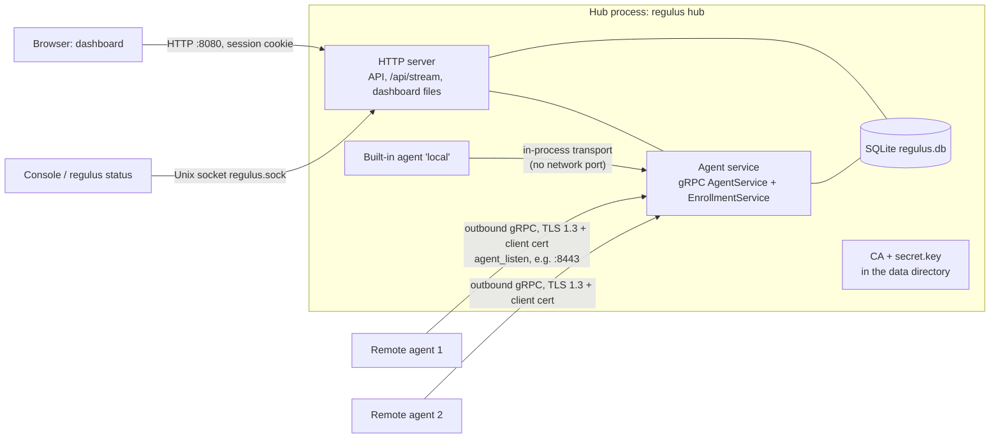
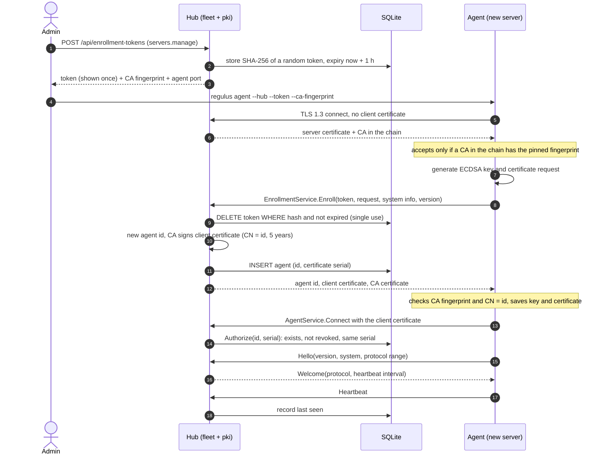
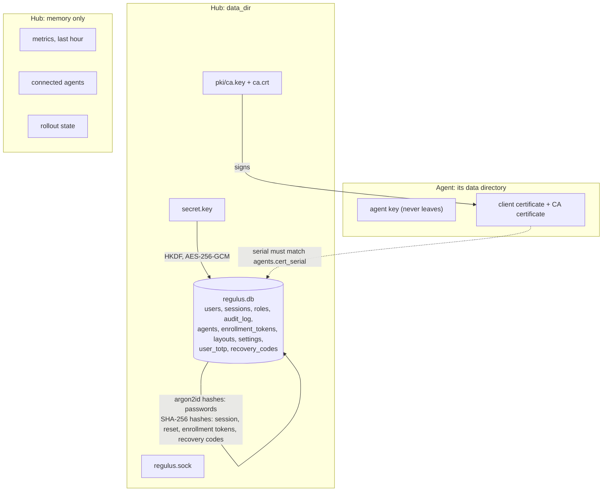
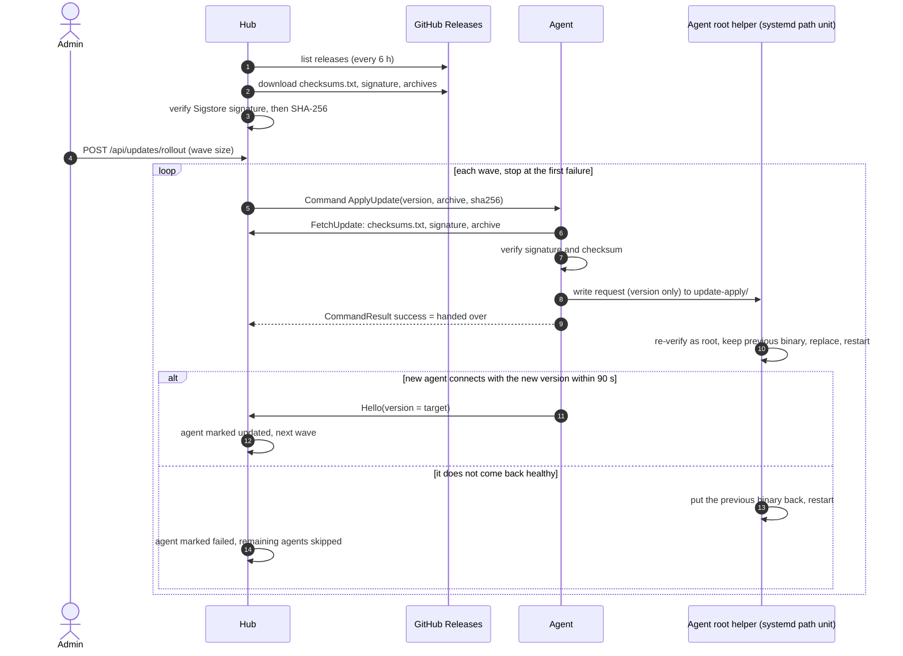

# Architecture

How Regulus fits together **today**, written for someone who has not seen the code. [README.md](../README.md) says what Regulus is and how to use it, [decisions.md](decisions.md) says why things are the way they are and what is open. This page says how the parts work, and links each statement to the code or to an issue.

Status words used below: **implemented** (the code exists and has tests), **planned** or **designed** (an issue or document exists, no code), **unverified** (the code exists but has not run on a real system; see #81). Nothing on this page is described as verified on a real machine: the release, the packages and the update path have not been tested on one yet (#81).

Terms are used as the code uses them. They are provisional; see the glossary when it exists (#116).

## 1. Components and roles

| Part | What it is | Where |
|---|---|---|
| **Hub** | The process everything talks to: serves the dashboard and the HTTP API, accepts agents, keeps the database, drives updates. | `regulus hub`; `internal/hub` |
| **Agent** | Reports one machine (system information, heartbeat, metrics) to a hub and runs the commands the hub sends. | `internal/agent` |
| **Built-in agent** | The agent that runs *inside* the hub process, so the hub's own server is managed like any other. Agent id `local`. On by default (`builtin_agent`). | `internal/hub/hub.go` (`BuiltinAgentID`, `startBuiltinAgent`) |
| **Remote agent** | The same agent code, run as `regulus agent` on another server. | `cmd/regulus/agent.go`, `internal/agent/remote.go` |
| **Console** | The full-screen terminal interface (`regulus` or `regulus console`) and its scriptable twins `regulus status` and `regulus config`. | `internal/console`, `cmd/regulus/console.go` |
| **Dashboard** | The React + TypeScript web interface, built by Vite and embedded in the binary. | `dashboard/`, `internal/webui` |

There is **one executable**, `regulus`. The role is chosen by the subcommand: `hub`, `agent`, `console` (the default), `status`, `config`, `update-apply`, `version` (`cmd/regulus/main.go`). The binary does not read a "role" setting.

The file `/etc/regulus/role` exists, but only for packaging: `install.sh --role agent` writes the word `agent` there and the package scripts read it to decide which directories and systemd units to set up (`packaging/install.sh` `set_role`, `packaging/scripts/postinstall.sh`). A hub install has no such file.

What runs on a machine depends on how it was installed (#16 is the open work to split the two roles fully):

| Setup | Processes | Notes |
|---|---|---|
| Hub with built-in agent (default) | `regulus hub` (`regulus.service`), agent inside it | Remote agents are off until `agent_listen` is set. |
| Hub only | `regulus hub` with `builtin_agent: false` | The hub's server is not managed. |
| Agent only | `regulus agent` (`regulus-agent.service`) | Needs `/etc/regulus/agent.yaml`; connects out to a hub. |

A separate, smaller agent package and turning an agent server into a hub are **designed, not implemented** (#102, #105). Hub redundancy and failover are the epic #103.

*Sources: `internal/hub/hub.go` (`Serve`, `serveAgents`, `startBuiltinAgent`), `internal/inproc`, `internal/localstatus`.*

## 2. The agent–hub contract

**Definition.** `proto/regulus/agent/v1`: `agent.proto` has `AgentService` (`Connect`, a bidirectional stream, and `FetchUpdate`, a server stream that sends release files to an agent) and `enrollment.proto` has `EnrollmentService` (`Enroll`). The Go code is generated into `internal/gen` with `make proto`; CI fails if the committed code is out of date (`make proto-check`). *Implemented.*

**Transport.**

- Remote agents connect **outbound** to the hub's agent listener: gRPC over TLS 1.3, with the hub's own CA and a client certificate per agent (`pki.CA.ServerTLS`, `pki.PinnedClientTLS`: `MinVersion: tls.VersionTLS13`). The listener is **off by default**: it starts only when `agent_listen` is set (`internal/hub/hub.go` `serveAgents`). No inbound port is needed on managed servers.
- The built-in agent uses the same service over `internal/inproc`, an in-memory gRPC transport with no network port and no certificate. It has no verified identity (`identityFrom` in `internal/hub/agent_net.go` finds none for it).

**A connection (`Connect`).** The agent sends `Hello` with its version, system information and the protocol range it speaks. The hub answers `Welcome` (the negotiated protocol version, the heartbeat interval, the metrics interval) or `Reject` with a reason (`internal/hub/agents.go` `Connect`). After that the agent sends `Heartbeat` and `MetricsReport` messages and the hub may send `Command` messages (`Ping`, `SetIntervals`, `ApplyUpdate`), each answered with a `CommandResult`.

- Heartbeat default: every 15 s. An agent silent for 2 intervals is reported `stale` in the API, for 3 intervals it is dropped (`defaultHeartbeatInterval`, `staleAfter`, `missedHeartbeats`).
- Metrics: the hub keeps the last hour per agent, at most 3600 samples, **in memory only** (`internal/hub/metrics.go`).

**Versions: protocol, and N / N-1.** Two separate checks (#17):

1. *Protocol version* (`internal/protocol`): the agent sends the range it speaks, the hub picks the highest both understand (`protocol.Negotiate`). Today `Version` and `MinSupported` are both `1`.
2. *Release series* (`internal/update/compat.go`, `CheckCompat`): the hub accepts agents of its own release series and the previous one (same minor, one minor behind, or any release of the previous major). Anything older is refused with `Reject_REASON_AGENT_TOO_OLD`; the agent keeps asking every few seconds. A development build is never judged. The hub is therefore updated first.

## 3. Trust and identity

Everything here is in `internal/pki` (certificates) and `internal/fleet` (tokens and the registry). *Implemented; unverified on a real second server (#81).*

- **Certificate authority.** At the first start with a database the hub creates a CA in `<data_dir>/pki/` (`ca.crt`, `ca.key`; the key is readable by the owner only). The CA is valid for 20 years (`pki.go` `caValidity`). Elliptic-curve P-256.
- **Hub certificate.** The agent listener's certificate is **made again at every start**, is valid for one year, and is not stored (`ServerCertificate`).
- **Fingerprint pinning.** The agent does not use public certificate authorities. It is given the SHA-256 fingerprint of the hub's CA (`sha256:…`, shown by the dashboard and in the hub log as `ca`) and accepts a connection only if the chain contains a CA with that fingerprint (`pki.PinnedClientTLS`, `verifyPinned`). This is why the token is never sent to an impostor.
- **Enrollment token.** Made by a user with `servers.manage` (`fleet.CreateToken`): 24 random bytes, shown once, stored only as a SHA-256 hash, valid for one hour (`TokenTTL`), **single use** (the row is deleted when used). Wrong tokens count against a limit of 10 per 15 minutes per address (`maxFailures`, `failWindow`). Every unknown, expired or used token gets the same answer (`ErrInvalidToken`).
- **Client certificate.** The agent makes its own ECDSA key and sends a certificate request; the key never leaves the machine. The hub **ignores the subject** of the request, picks the agent id and signs a certificate whose common name is that id (`CA.SignClient`). It is valid for **5 years** (`ClientValidity`). **Renewal is not implemented** (a comment in `pki.go` says so; tracked in #128).
- **Identity.** On every stream the hub reads the agent id and certificate serial number from the verified certificate, never from what the agent says, and calls `fleet.Authorize`: the agent must exist, not be revoked, and the serial must be the one issued for it (`requireAgent` in `internal/hub/agent_net.go`). `Enroll` is the only call that works without a certificate; the TLS server asks for a client certificate "if given" and verifies it against the CA (`VerifyClientCertIfGiven`).
- **Revocation.** `fleet.Revoke` marks the agent in the database; the hub closes its connection; the agent can never connect again (`DELETE /api/agents/{id}`). There is no revocation list to distribute, because the hub checks the registry on every connection.
- **Registry.** Table `agents` (id, name, hostname, certificate serial, `last_seen`, revoked time…). `internal/fleet` also records audit events (`agent_enrolled`, `agent_revoked`, …).

### Diagram: enrolling an agent

*Sources: `internal/fleet/fleet.go` (`CreateToken`, `Enroll`, `Authorize`), `internal/pki/pki.go` (`SignClient`, `ServerCertificate`), `internal/agent/remote.go` (`Enroll`, `Dial`), `internal/hub/agent_net.go`, `internal/hub/agents.go` (`Connect`). An order detail: a token is deleted before the request is checked, so a malformed request wastes the token (`fleet.go` comment).*

## 4. Humans and access

Everything is in `internal/auth`. *Implemented.*

- **Accounts.** Local, in the database; no email. On first start with no accounts the hub logs a one-time **setup token**; the dashboard asks for it with the first admin's username and password. The token is regenerated at each start until an admin exists.
- **Passwords** are hashed with argon2id (`password.go`), 10 to 128 characters.
- **Sessions** last 7 days (`SessionTTL`); the database stores only the SHA-256 of the token; the cookie is `HttpOnly`, `SameSite=Lax`, and `Secure` over HTTPS. Everything under `/api/` except `/api/auth/*` needs a login.
- **Rate limit** on failed logins, reset tokens and two-factor codes: 10 per 15 minutes per client address (`maxFailures`, `failureWindow`). Behind a reverse proxy all clients share the proxy's address.
- **Roles and permissions.** A user has a role; a role is a set of named permissions (`servers.read`, `servers.manage`, `layout.edit`, `users.manage`, `roles.manage`, `audit.read`, `core.update`). Endpoints check permissions, not role names. Built-in roles: `admin`, `operator`, `viewer`; custom roles are stored in the `roles` tables (`permissions.go`, `roles.go`). **"Role" here is a different thing from the node role of section 1.**
- **Two-factor (TOTP).** Optional per user, or required by policy; ten single-use recovery codes stored as hashes. The TOTP secrets are encrypted with AES-256-GCM under a key derived (HKDF) from `secret.key` in the data directory (`secret.go`). Without `secret.key` two-factor is unavailable (`ErrTwoFactorUnavailable`). A copy of the database alone does not reveal the secrets, so back up both.
- **Reset of lost credentials.** An admin makes a one-time reset link (token hashed, valid one hour). If the admin is locked out, `regulus hub reset-admin` on the machine does the same; access to the data directory is the proof of ownership.
- **Audit log.** Table `audit_log`, newest 10,000 kept; agent enrollment and update events go there too.
- **Passkeys** (WebAuthn) are **planned** (#50).

Agents do not use any of this: they authenticate with client certificates (section 3).

## 5. Data

**Which databases.** Only **SQLite** is implemented: `modernc.org/sqlite`, a pure-Go driver, in `internal/storage` (`storage.go`; `go.mod` has no other driver). The README used to say "PostgreSQL optional"; that was not true. The maintainer decided that PostgreSQL will be supported, chosen in the installer (#122, #123), with moving data between the two from the WebUI and the TUI later (#124). **Until #122 ships, PostgreSQL is planned, not available.**

**Migrations.** `internal/storage/migrations/0001` to `0009`, embedded in the binary, applied in order at startup and recorded:

| Migration | Adds |
|---|---|
| 0001 | `settings` |
| 0002 | `users`, `sessions` |
| 0003 | `dashboard_layouts` (per user) |
| 0004 | `audit_log` |
| 0005 | `password_resets` |
| 0006 | `enrollment_tokens`, `agents` |
| 0007 | agent presence (columns on `agents`) |
| 0008 | `user_totp`, `recovery_codes`, `pending_logins` |
| 0009 | `roles`, `role_permissions` (recreates `users`) |

**The data directory** (`data_dir`; `/var/lib/regulus` with the package, `data` by default):

| Path | What | Sensitivity |
|---|---|---|
| `regulus.db` | everything in the tables above | contains hashes and encrypted TOTP secrets |
| `secret.key` | master secret for TOTP encryption; created at first start | owner-only; **back up with the database** |
| `pki/ca.crt`, `pki/ca.key` | the CA | `ca.key` owner-only; whoever has it can issue agent certificates |
| `regulus.sock` | Unix socket for local tools (console, `regulus status`), mode `0600`, owner = the user running the hub | no login; file permissions are the proof |
| `updates/` | downloaded, verified releases | |
| `tuf/` | cache of the Sigstore trusted root | |
| `update-apply/` | request/result files exchanged with the root update helper | |

**In memory only** (lost on hub restart): metrics history, the list of connected agents and their sessions, the rollout state, the broker of live events, the memory of refused agents.

On an agent, the data directory (`/var/lib/regulus-agent` with the package) holds the agent's key, certificate and the CA certificate (`internal/agent/remote.go` `Credentials.save`), plus `updates/` and `update-apply/` when self-update is on.

### Diagram: what is stored where

*Sources: `internal/auth/secret.go`, `internal/auth/password.go`, `internal/pki/pki.go`, `internal/fleet/fleet.go`, `internal/storage/migrations`.*

## 6. Updates

*Implemented; **unverified on a real system** (#81).* The goal is "install once": after the first installation nothing is installed by hand (decisions.md, "Updates").

1. **Finding releases** (`internal/update`: `source.go`, `manager.go`). The hub reads the GitHub Releases of this repository without a token, every 6 hours (`DefaultCheckEvery`), a minute after start for the first time. Channel: `stable`, `beta` or `alpha`. A development build never asks.
2. **Mode** (`manager.go`, `Mode`): `manual` (only tell), `download` (download and verify, wait for an administrator; **the default**), `automatic` (install inside a maintenance window). Settings need `core.update`.
3. **Verification** (`signature.go`, `stage.go`). First the Sigstore signature of `checksums.txt` is checked in-process (certificate must name this repository's release workflow at the release tag, issued by GitHub Actions, with a transparency log entry); then the archive's SHA-256 is compared with the list. A release that fails is deleted. The trusted root is fetched from Sigstore's TUF repository into `tuf/`, with a snapshot built into the binary as fallback.
4. **Installing on the hub** (`apply.go`, `installer.go`). The hub runs as the unprivileged user `regulus`. It writes a request that names only a version into `update-apply/`; a systemd path unit (`regulus-update.path`) starts `regulus update-apply` as root, which checks everything **again** itself, refuses a version that is not newer, replaces `/usr/bin/regulus` and restarts the hub, keeping the old binary. It then waits up to 90 s for the service to be healthy and report the new version, stable for 15 s (`HealthTimeout`, `Stable`); if not, it puts the old binary back (`rolled_back`).
5. **Rolling out to agents** (`internal/hub/rollout.go`, `internal/agent/update.go`). An administrator (or the automatic mode) starts a rollout of the connected, older, Linux, non-built-in agents, in waves of N at a time, stopping at the first failure. For each agent the hub sends `ApplyUpdate`; the agent fetches `checksums.txt`, its signature and **its own platform's archive from the hub** over its existing mTLS connection (`FetchUpdate`), verifies them, and leaves a request for **its own** root helper (`regulus-agent-update.path`). The agent is healthy when it **connects again with the new version**; otherwise its helper rolls back.

### Diagram: update rollout with rollback

*Sources: `internal/hub/rollout.go` (states `offered`, `installing`, `updated`, `failed`, `skipped`; `WaveSize`; `returnTimeout` 10 minutes), `internal/agent/update.go`, `internal/update/installer.go`, `packaging/regulus-agent-update.path`. The helper's own checks are the same code as the hub's (`regulus update-apply`). The hub's own update follows steps 1 to 4 with the hub as the restarted process.*

## 7. Interfaces

| Interface | Where | Notes |
|---|---|---|
| **Dashboard** | `dashboard/` (Vite + React + TypeScript), embedded by `internal/webui`; served by the hub on `listen` (default `:8080`, plain HTTP) | Widgets are registered in `dashboard/src/widgets/` with `registerWidget`. The layout is saved per user via `/api/layout`. |
| **HTTP API** | `internal/hub/api.go` and friends; described in `internal/hub/openapi.yaml`, served at `/api/openapi.yaml`; a test keeps the file in step with the routes | Needs a login except `/api/auth/*`, `/healthz` and the dashboard files. |
| **Live stream** | `GET /api/stream`, a WebSocket (`internal/hub/stream.go`, `events.go`) | Sends a `snapshot`, then `agent.connected`, `agent.disconnected`, `agent.heartbeat`, `agent.metrics`. Needs the session cookie, refuses other origins, disconnects slow readers. |
| **Agent listener** | `agent_listen` (for example `:8443`), gRPC over TLS | **Off by default.** Open the port only towards managed servers. |
| **Local socket** | `<data_dir>/regulus.sock` (`internal/localstatus`) | Used by the console and `regulus status`; no login. |

There is no TLS on the dashboard port; put a reverse proxy in front outside a trusted network.

## 8. Startup and lifecycle

**Hub** (`regulus hub`, `cmd/regulus/main.go` then `internal/hub/hub.go`):

1. Load the configuration: defaults, then the YAML file, then environment variables, then flags (`internal/config`).
2. `hub.New`: open the database and apply migrations (`storage.Open`); load or create `secret.key`; create the account service; load or create the CA in `pki/`; create the fleet service, the agent service and the in-process transport; create the update manager and stager.
3. `Hub.Serve`: register the agent service on the in-process transport; if `agent_listen` is set, start the network listener (a new hub certificate is made now); if `builtin_agent` is true, start the built-in agent; start the local socket; start the rollout timer (every 5 minutes it checks whether the automatic mode should roll out) and the update manager loop; finally serve HTTP.
4. On cancel (SIGINT/SIGTERM) the HTTP server shuts down gracefully; agent streams are stopped abruptly because they are long-lived.

**Agent** (`regulus agent`): load the saved credentials, or enroll if a token was given; dial the hub; `agent.Run` sends `Hello`, then heartbeats and metrics. A version refusal does not stop it: it retries every few seconds. A revoked agent stops for good. gRPC re-makes a dropped connection.

**What survives a restart.** The database, `secret.key`, the CA and the agent credentials do. The metrics history, the list of connected agents (they reconnect) and rollout state do not. Sessions survive, because they are in the database.

## 9. Packaging and deployment

`install.sh` and the `.deb` / `.rpm` / `tar.gz` built by GoReleaser from `.github/workflows/release.yml` install `/usr/bin/regulus`, the systemd units (`packaging/`), `/etc/regulus/config.yaml`, and the service user `regulus`. `install.sh --role agent --hub … --token … --ca-fingerprint …` sets up an agent. The user-facing steps are in the README until they move into `docs/` (#117). *Unverified on a real Ubuntu system (#81).*

## 10. What does not exist yet

- **Plugins**: designed only (`docs/plugins.md`; #19 to #23). No plugin runs.
- **Containers** and workload management: not started (#113).
- **Hub redundancy, promotion and failover**: designed in the issues of epic #103, not implemented. In particular **the hub address list and the term (epoch) concept do not exist anywhere in the code** (checked with `grep` on 2026-10-29), so nothing on this page about connections to "the hub" assumes more than one.
- **PostgreSQL**: planned (#122 to #124).
- **Agent certificate renewal**: not implemented (see section 3).
- **Server inventory** (#62) and **AI Support** (#63): designs only.

## Code map

| Path | Responsibility |
|---|---|
| `cmd/regulus` | the single executable; chooses the role by subcommand |
| `internal/config` | configuration (defaults, YAML file, environment, flags) and the editable settings |
| `internal/console` | interactive console (Bubble Tea) and the plain-text/JSON status and settings output |
| `internal/localstatus` | the Unix socket where a running hub reports to local tools |
| `internal/logging` | structured logging |
| `internal/storage` | SQLite database and migrations |
| `internal/auth` | local accounts, roles, sessions, two-factor, reset, and the HTTP login endpoints |
| `internal/pki` | the hub's certificate authority, agent keys, fingerprint pinning |
| `internal/fleet` | enrollment tokens, the registry of remote agents, revocation |
| `internal/hub` | the hub: HTTP server and API, agent service, live stream, rollout |
| `internal/update` | finding releases, the download cache and its checks, installing with a rollback (hub and agent) |
| `internal/agent` | agent runtime (client side of the contract), metrics collector, remote enrollment; also the built-in agent |
| `internal/protocol` | protocol version of the agent–hub contract |
| `internal/inproc` | in-memory gRPC transport (built-in agent) |
| `internal/gen` | generated Go code for `proto/` (do not edit) |
| `internal/webui` | embeds the compiled dashboard |
| `dashboard` | React + TypeScript dashboard |
| `packaging` | systemd units, default config, maintainer scripts, `install.sh` |
| `proto` | Protobuf contract between agents and the hub |
| `docs` | this page, design decisions, the plugin design draft |

## Gaps found while writing this page

- Agent certificate renewal (5-year certificates, no renewal): opened as #128.
- The README claimed PostgreSQL support that did not exist; corrected in the same pull request as this page.
- The README's code map omitted `internal/pki` and `internal/fleet`; this page has the complete map and the README's copy is handled in #117.
