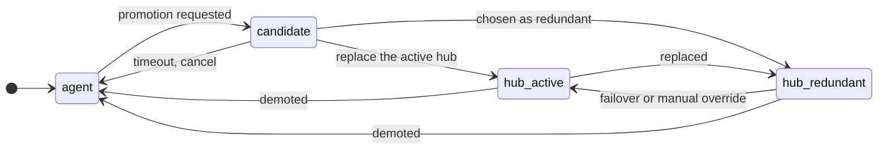
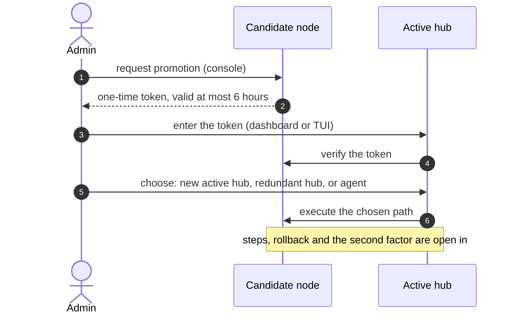
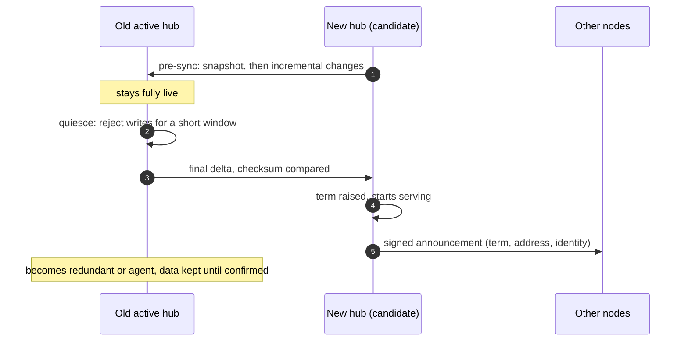

# Hub promotion, redundancy and failover

The guide to the result of the epic [#103](https://github.com/CodexCircle/Regulus/issues/103): promoting an agent into a hub, a redundant (standby) hub, and failover. It is **written as the design issues close**. Today it is a skeleton: nothing here is implemented, and most of it is not even designed yet.

Each section has a **status line**:

- *not designed*: the issue is open and has no decision; only the maintainer's inputs and the open questions are listed.
- *designed*: the decision is recorded in [decisions.md](decisions.md) and written here.
- *implemented*: code exists (linked).
- *verified*: and it was run, with the setup and result written down (see AGENTS.md: do not overstate verification).

A design issue of #103 is **not complete** until its section exists here and its decision is in [decisions.md](decisions.md). Terms are in the [glossary](glossary.md) (status "proposed in #103"); the surrounding system is in [architecture.md](architecture.md). Names are provisional.

Admin-facing instructions (commands, dashboard screens) are added **after** implementation, with the real command names. Command names that appear below, such as `regulus promote`, are *proposed*.

## 1. Overview

*Status: not designed.*

Today there is **one hub per server group** and every other server is an agent ([architecture.md](architecture.md), section 1). The epic changes the rule to "one *active* hub per term": other hubs may exist, but only passively (a **redundant hub**) or inactively (a **candidate**). A redundant hub receives a copy of what the active hub needs to act as the hub and takes over when the active hub is unreachable, or when the administrator forces it.

Baseline decisions by the maintainer (#103): a single active hub at all times, so a network split must lead to temporary unavailability rather than two active hubs; terms (epochs) as the base mechanism against split brain; English and Italian in the GUI.

What does not exist in the code today: a list of hub addresses on the agent, the term concept, any replication, any role other than hub and agent. Checked on 2026-10-29.

## 2. Roles and transitions ([#104](https://github.com/CodexCircle/Regulus/issues/104))

*Status: not designed.*

Proposal in the issue: roles `agent`, `hub` (active), `hub-redundant`, and the transient state `candidate`; `pure-hub` is an attribute of the hub roles; modelled as an enum plus capability flags. The issue also asks for a transition table (trigger, preconditions, persisted state, announced to whom, how to undo), invariants (at most one active hub per term; a redundant hub of a pure-hub is a pure-hub) and where the role and term are stored.

*Draft, drawn from the list of transitions in #104 and the maintainer's decisions in #103. Not decided; the table with triggers and preconditions is the work of #104. The old hub returning after a failover is #110 and is not shown.*

## 3. Promoting a node ([#105](https://github.com/CodexCircle/Regulus/issues/105))

*Status: not designed.*

Maintainer decisions (#103): promotion is requested on the candidate, which generates a one-time **token**; the administrator enters it on the active hub (dashboard or TUI); the administrator's password as a second factor is wanted but may come later; a pending request expires after **at most 6 hours**; each node has a setting **accept promotion autonomously**, **off by default**. A promoted node stays inactive until the administrator chooses what it becomes: the new active hub, a redundant hub, or back to a plain agent. The active hub can also demote a node.

Proposed command: `regulus promote` with `request`, `status`, `cancel` and `demote`. The name is to be confirmed in #105.

*Draft from the flow in #105. Not decided.*

## 4. What the redundant hub replicates ([#106](https://github.com/CodexCircle/Regulus/issues/106))

*Status: not designed.*

Maintainer decisions (#103): everything the hub needs to act as the hub is replicated; Regulus-internal secrets and tokens are generated again for the redundant hub and tested periodically (copied only if regeneration is impossible); externally issued tokens are copied; **containers are replicated as definitions, never as data**.

Open in #106: the inventory table (copied, regenerated, never copied), RPO and RTO, downtime of a planned switch, behaviour when the two hubs run different release series, encryption, verification of lag and consistency, initial sync and resync, resource limits. The choice between mechanisms depends on the database in use; **today only SQLite is implemented** (PostgreSQL is planned: #122 to #124).

| Item | Copied / regenerated / never copied | Source |
|---|---|---|
| *to be filled when #106 is decided* | | |

## 5. Trust and the secure channel ([#107](https://github.com/CodexCircle/Regulus/issues/107))

*Status: not designed.*

What exists today and the new design builds on ([architecture.md](architecture.md), section 3): a CA created by the hub, agents pinning its fingerprint, 5-year client certificates, no certificate renewal (#128). Open in #107: the trust model options, what agents pin when the hub changes, the hub-to-redundant channel (the existing gRPC with mutual TLS is the baseline), signed hub-change announcements with replay protection, promotion token security, certificate lifecycle and revocation of a retired hub, and the threat model. Raspberry Pi class hardware must be supported.

## 6. Failure detection, terms and split-brain prevention ([#108](https://github.com/CodexCircle/Regulus/issues/108))

*Status: not designed.*

Maintainer rules (#103): terms (epochs) are accepted; keep a single active hub; **partition-tolerant operation is not supported** (it is in the backlog, [#113](https://github.com/CodexCircle/Regulus/issues/113)); the rule must prefer temporary unavailability over two active hubs. Open in #108: term semantics, which signals count as failure, the activation rule, how agents find the standby, fencing of a hub that learns of a higher term, flapping control, observability, and an end-to-end test plan. Defaults will be listed here when decided.

## 7. Changing the active hub ([#109](https://github.com/CodexCircle/Regulus/issues/109))

*Status: not designed.*

Two parts in the issue: how every node learns of the change (options compared: push over the existing connection, a pre-distributed address list, peer query, LAN broadcast as a hint only, MQTT), and a planned switch with minimal downtime (pre-sync, short quiesce, final delta, switch with a higher term, old hub becomes redundant or an agent, rollback). Measured downtime will be written here when it can be measured.

*Draft from "Part 2" of #109. Not decided.*

## 8. The old hub returns ([#110](https://github.com/CodexCircle/Regulus/issues/110))

*Status: not designed.* The issue says the meaning of *failback* is **not settled**; the maintainer's starting hypothesis is that the old primary knows it was not operative, contacts the redundant hub, realigns as its redundant until everything is copied, and control returns gradually. The issue proposes that the old hub starts fenced (read-only) and that failback is always approved by the administrator. This section, and its failback diagram, are written once the meaning is clarified.

## 9. Agents without a hub, and workloads on hubs ([#111](https://github.com/CodexCircle/Regulus/issues/111))

*Status: not designed.*

Maintainer decisions (#103): containers on other nodes keep running if the hub dies, and those nodes lose only the functions that need a hub (to be inventoried); a hub may host containers **only when it is not a pure-hub**, with built-in orchestration modules (for example nginx or Tailscale) as the exception. Open: the inventory of hub-dependent functions, reconnection with an ordered hub list, local indication of "no hub since…", behaviour of expired certificates in a long outage, how pure-hub is enforced, the warning on non-pure hubs, and the supported minimum hardware.

## 10. Out-of-band channel ([#112](https://github.com/CodexCircle/Regulus/issues/112))

*Status: not designed.*

A second channel (email, Telegram or another, to be chosen) is wanted for notifications and for manual override. Open: a small provider interface, proof that an incoming command is authentic (a chat account is not enough), no secrets in messages, independence from the failing hub, rate limiting, and the configuration screens in English and Italian.

## 11. Not yet ([#113](https://github.com/CodexCircle/Regulus/issues/113))

Parked on purpose: containers (runtime not decided), redundancy of a single container, more than one redundant hub with priority, microcontroller (ESP) hubs, other node types, and partition-tolerant operation.

## 12. Operations

*Status: not written.* How to check replication health, how to test a failover safely and troubleshooting are written **after** implementation, with the real commands. This guide is not done until that section has been run by someone other than its author on a test group (a hub, a redundant hub and two agents).
